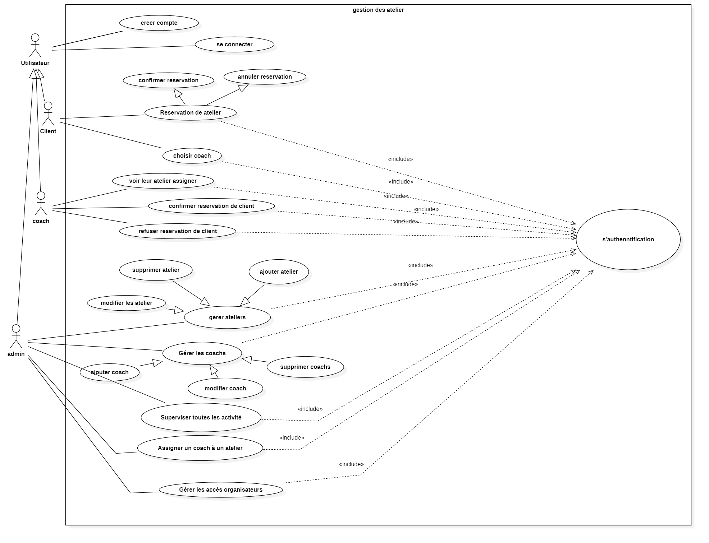
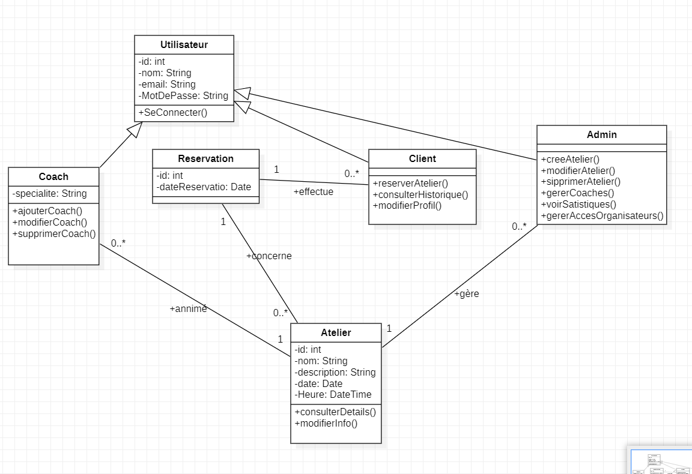
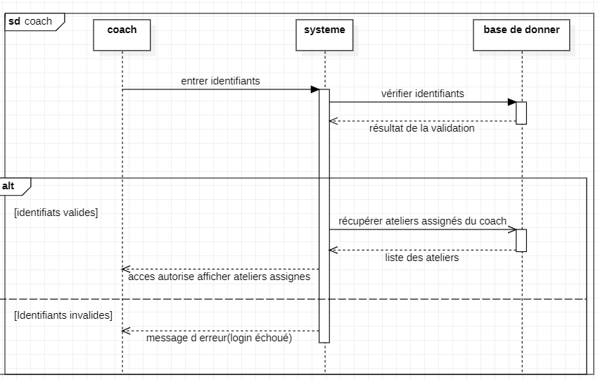
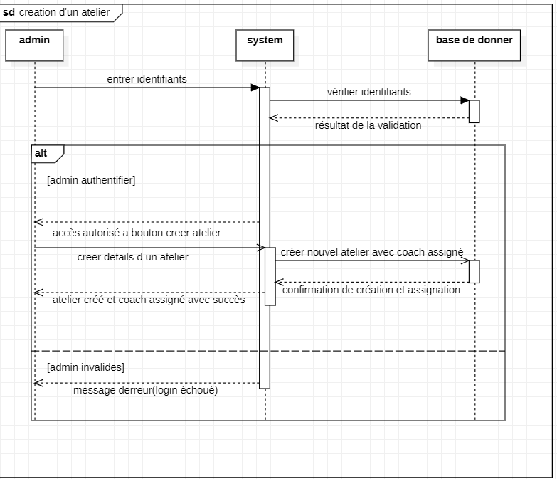

##  Diagram de Use Case

##  Diagram de classe

##  Diagram de Sequence afficher ler atelier assignier a un coach

##  Diagram de Sequence de creation d'un atelier par admin

##  Diagram de Sequence user
